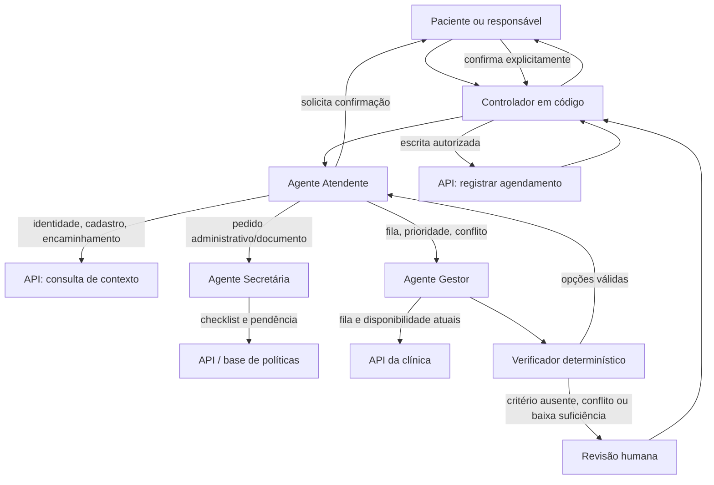

# Arquitetura-alvo

> Este documento descreve o desenho-alvo. O repositório tem uma API local de usuários/agendamentos e um Atendente com ferramentas HTTP básicas; não há integração com clínica real, consulta de horários livres, nem os três agentes especializados.

## Grafo implementado do Atendente

O fluxo executado pelo CLI é compilado por
`src/agent/workflows/scheduling.py::build_scheduling_graph`. Este é o fluxo
real; não inclui os agentes Gestor/Secretária nem um nó RAG dedicado.
Orçamento de execução, expiração da aprovação, classificação de término e
detecção de chamadas repetidas são implementados no grafo.

A busca RAG é oferecida como ferramenta `consultar_politica` dentro de
`dispatch_tools`; ela não é um nó separado do grafo. O índice local ainda não
contém políticas oficiais.

```text
START
+-- ação pendente e sem decisão ------> validar profissional, se necessário
|                                         +-- profissional válido -> request_approval
+-- caso contrário -------------------> call_model

call_model
+-- resposta final/limite/erro -------> END
+-- agendamento sem login ------------> require_authentication -> END
+-- agendamento autenticado ---------> validate_professional
+-- outra tool call -----------------> dispatch_tools

validate_professional
+-- profissional válido -------------> request_approval
+-- erro ou limite ------------------> END

request_approval
+-- aprovado ------------------------> revalidate_availability
+-- editado -------------------------> validate_professional -> request_approval
+-- resposta inválida ---------------> END (proposta pode ser retomada)
+-- rejeição/expiração/erro ---------> END

revalidate_availability
+-- horário disponível -------------> dispatch_tools
+-- indisponível/erro/limite --------> END

dispatch_tools
+-- término final/erro/limite -------> END
+-- caso contrário -------------------> call_model
```

Para inspecionar o objeto compilado usado pelo agente, execute da raiz:

```text
poetry run python conferir_grafo.py
```

O script importa `build_scheduling_graph` e compila esse mesmo grafo com
dependências placeholder; não cria um grafo paralelo nem chama LLM/API.
Saída atual:

```text
Nos:
  __end__
  __start__
  call_model
  dispatch_tools
  request_approval
  require_authentication
  revalidate_availability
  validate_professional
Arestas:
  __start__ -> call_model [condicional]
  __start__ -> request_approval [condicional]
  __start__ -> validate_professional [condicional]
  call_model -> __end__ [condicional]
  call_model -> dispatch_tools [condicional]
  call_model -> request_approval [condicional]
  call_model -> require_authentication [condicional]
  call_model -> validate_professional [condicional]
  dispatch_tools -> __end__ [condicional]
  dispatch_tools -> call_model [condicional]
  request_approval -> __end__ [condicional]
  request_approval -> request_approval [condicional]
  request_approval -> revalidate_availability [condicional]
  request_approval -> validate_professional [condicional]
  require_authentication -> __end__ [condicional]
  revalidate_availability -> __end__ [condicional]
  revalidate_availability -> dispatch_tools [condicional]
  validate_professional -> __end__ [condicional]
  validate_professional -> request_approval [condicional]
```

## Resumo do desenho-alvo (não implementado integralmente)

O desenho proposto atende pacientes e responsáveis de uma clínica de avaliações neuropsicológicas por mensagens. Um controlador em código coordenaria três agentes especializados: Atendente, Gestor e Secretária. Eles consultariam dados autorizados na API, manteriam a agenda e as pendências como fonte de verdade e devolveriam respostas com fonte e suficiência. O modelo interpreta linguagem e prepara decisões; código valida regras e executa ferramentas. Agendamento só seria gravado depois da confirmação do paciente. Hoje, o repositório implementa apenas um Atendente com consulta e gravação básica pela API local.

## Diagrama da arquitetura-alvo



## Roteamento e workflow

O roteador identifica uma destas intenções: **agendamento**, **consulta de dados/fila**, **cancelamento ou remarcação**, **documentos/encaminhamento**, **reclamação** ou **orientação administrativa**. A linguagem natural pode combinar intenções; o controlador cria tarefas separadas e preserva um estado único da conversa. Se faltar informação, houver contradição ou a política não existir, o fluxo pergunta ou encaminha para uma pessoa autorizada.

| Etapa | O que acontece | Quem decide | Ferramenta/escrita | Verificação e reversibilidade |
|---|---|---|---|---|
| 1. Receber e classificar | Interpretar a mensagem e selecionar intenção(ões) | Modelo propõe; código valida as rotas permitidas | Nenhuma | Entrada não reconhecida retorna pedido de esclarecimento |
| 2. Identificar e consultar | Validar identidade/contexto e ler cadastro, encaminhamento, fila e agenda necessários | Código aplica autorização; modelo não escolhe o identificador | Consulta somente leitura à API | API é fonte de verdade; sem identidade autorizada, não revelar dados |
| 3. Tratar pendência administrativa | Conferir se os itens exigidos pela política vigente estão presentes | Secretária aponta pendências; código confere checklist; humano valida conteúdo clínico | Criar ou atualizar tarefa administrativa | Tarefa pode ser reaberta; conteúdo clínico não é inferido |
| 4. Analisar fila | Aplicar somente critérios de prioridade aprovados e versionados | Gestor organiza evidências; código/verificador confere regra e schema; humano aprova exceções | Consulta à API | Sem regra aprovada ou dados suficientes, não calcular prioridade e escalar |
| 5. Propor agenda | Cruzar prioridade autorizada, preferência e disponibilidade atual | Gestor propõe; código checa disponibilidade, conflito e capacidade | Consulta somente leitura | Cada opção deve corresponder a um horário livre retornado pela API |
| 6. Confirmar com paciente | Apresentar fonte, opções e pedir confirmação inequívoca | Paciente decide | Nenhuma | Sem confirmação, não há escrita; silêncio ou ambiguidade não contam como consentimento |
| 7. Registrar ou encaminhar | Gravar agendamento confirmado ou registrar pedido pendente de cancelamento/remarcação | Código executa; paciente confirma agendamento; humano aprova exceções | Escrita na API com chave de idempotência | Não apagar histórico; alteração precisa de trilha de auditoria. Cancelamento só muda status após política oficial e confirmação cabível |
| 8. Responder e encerrar | Informar resultado, fonte e suficiência; registrar metadados mínimos da execução | Código formata objeto; modelo redige a mensagem | Log técnico minimizado | Erro de ferramenta vira estado/resultado explícito e pode ser encaminhado a humano |

## Ferramentas e fronteiras

As ferramentas abaixo são contratos propostos para o desenho completo. A API local implementa usuários e registros de agendamento, mas não modela encaminhamento clínico, fila ou consulta de horários livres. O Atendente tem apenas consulta e gravação básica; os demais contratos e verificações ainda precisam ser implementados.

| Ferramenta | Finalidade | Leitura/escrita | Reversibilidade e confirmação | Interface/fonte |
|---|---|---|---|---|
| `consultar_contexto_paciente` | Ler cadastro e estado do encaminhamento após autenticação | Leitura | Sem alteração de dados | API da clínica; identidade autenticada, nunca nome como chave de busca |
| `consultar_fila_e_disponibilidade` | Ler posição/status disponível, exames pendentes e horários livres | Leitura | Sem alteração de dados | API da clínica; dados atuais, não RAG |
| `abrir_pendencia_administrativa` | Registrar documento faltante ou solicitar revisão | Escrita | Pode ser fechada/reaberta com histórico; não altera prontuário | API/tarefa administrativa; exige paciente/caso autorizado e motivo estruturado |
| `registrar_agendamento` | Reservar a opção que o paciente confirmou | Escrita | Não há exclusão física; cancelamento posterior é fluxo separado e auditado. Exige confirmação explícita e chave de idempotência | API da clínica; valida disponibilidade novamente no momento da escrita |
| `registrar_pedido_de_cancelamento` | Registrar solicitação para processamento conforme política | Escrita pendente | Não cancela por si só; gestor/humano confirma a ação conforme regra aprovada | API da clínica; preserva o agendamento até decisão válida |

Os dados de paciente, encaminhamento e agenda vêm da API. O RAG pode responder somente regras administrativas publicadas e vigentes, como documentos exigidos e procedimento aprovado para cancelamento. Se a fonte não existir ou estiver desatualizada, a resposta é insuficiente.

## Estado compartilhado

O controlador mantém um estado mínimo para retomar o fluxo:

- `conversation_id` e `patient_id` autenticado, quando disponível;
- rota(s), etapa atual e identificador da tarefa;
- preferência de horário, encaminhamento (estado/status, não cópia do documento), prioridade e versão do critério, se autorizados;
- opções devolvidas pela API, opção escolhida, confirmação explícita e resultado da escrita;
- pendências, fonte consultada, suficiência, tentativas e erro de ferramenta.

Agentes recebem apenas os campos necessários para sua tarefa. Não se copia laudo ou histórico completo para o estado, prompt ou log. O conteúdo clínico permanece na API oficial, sujeito às regras institucionais de acesso e retenção.

## Laço, orçamento e término

- **Laço de conversa:** permanece ativo enquanto houver pergunta ou ação pendente e o paciente quiser continuar.
- **Laço de dados:** pergunta um campo necessário, atualiza o estado e repete a consulta; não volta a pedir um dado já confirmado sem motivo.
- **Limites do protótipo:** o grafo aplica até 8 etapas, 10 chamadas externas combinadas, 12.000 tokens reportados pelo provedor e 120 segundos por turno. Cada chamada externa tem timeout de até 30 segundos, cada resposta do modelo é limitada a 1.000 tokens e o LangGraph recebe `recursion_limit=32`, separado do limite de etapas. Uma ferramenta que falha ainda consome orçamento. Esses limites são barreiras de engenharia; não são resultados de benchmark.
- **Aprovação e idempotência:** a aprovação expira após 120 segundos. A ação aprovada é identificada por hash da conversa, ferramenta e argumentos canônicos; o checkpoint do grafo registra resultados aplicados e impede repetir a escrita dentro do mesmo processo/thread. Se uma proposta repetida chegar em outro turno sem a chave explícita no estado, o grafo recomputa a chave e reconhece a ação já concluída. O protótipo ainda usa `MemorySaver`: não garante deduplicação após reinício do processo nem cobre uma falha entre a escrita externa e a persistência do checkpoint; idempotência durável na API é trabalho pendente.
- **Término normal:** conclusão da consulta, agendamento confirmado, solicitação registrada como pendente ou não há ação disponível. O encerramento do usuário é identificado separadamente.
- **Término seguro:** cadastro não localizado, encaminhamento ausente/inválido, contradição não resolvida, insuficiência de fonte, falha repetida da API ou orçamento atingido. A resposta explica o limite e o próximo passo; não simula sucesso.
- **Motivos e falhas:** o estado interno distingue conclusão normal, encerramento, limite, recusa, aprovação expirada, laço improdutivo, erro recuperável e erro fatal. Erros recuperáveis cobrem falhas de runtime/timeout/conexão; entradas inválidas e violações de invariantes são fatais. Repetir a mesma consulta de leitura é detectado antes de nova chamada e não depende do `recursion_limit`.
- **Erro como dado:** o estado registra a classe e o motivo da interrupção, sem copiar detalhes de exceções, segredos ou conteúdo clínico para a resposta.

## Complexidade e encaminhamento humano

| Situação | Resposta do sistema |
|---|---|
| Informação necessária não foi fornecida | Solicitar somente o campo ausente e explicar por que é necessário |
| Mensagem e cadastro divergem | Não escolher silenciosamente; confirmar com paciente ou encaminhar ao responsável |
| Fonte ou regra é insuficiente | Dizer que não consegue confirmar e apontar a fonte que falta |
| Risco, exceção, prioridade sem política, conflito ou erro persistente | Suspender escrita e criar encaminhamento humano com contexto mínimo |

O humano pode interromper a conversa. O responsável da clínica revisa prioridade e exceções; o paciente/responsável confirma o próprio agendamento.

## Nível de autonomia

O protótipo implementa um agente Atendente com ferramentas e workflow sequencial: interpreta mensagens abertas, consulta dados da API local e pode propor um agendamento. Não coordena as três especialidades do desenho-alvo nem usa planejamento autônomo aberto; os limites são sensíveis, as escritas têm efeito e a política pode estar incompleta. A autonomia fica restrita a consultar, pedir esclarecimentos, preparar a ação e gravar somente após aprovação explícita.
