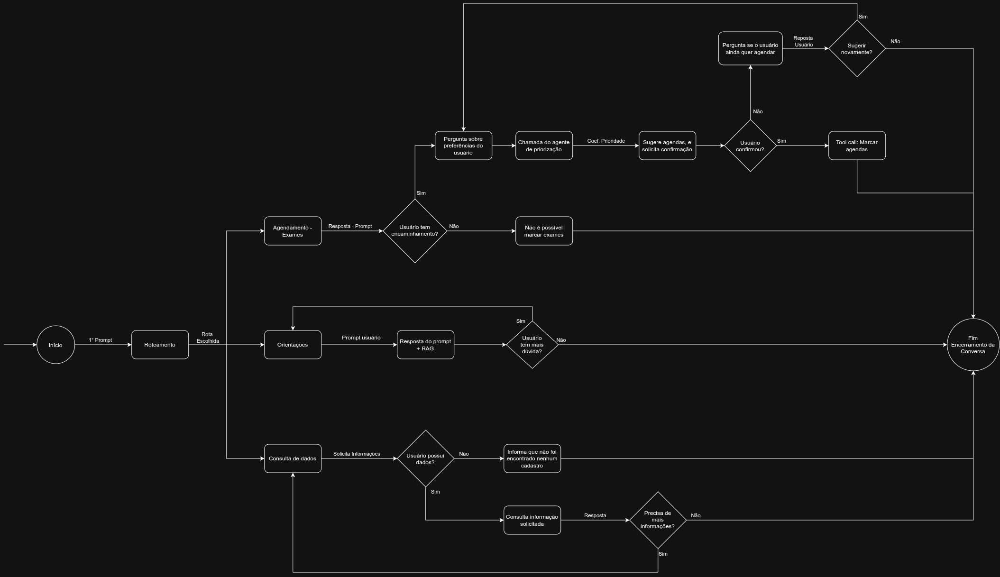

# Diagrama

# Ferramentas
- **Simulação dos exames:** A partir do estado atual da clínica e na suspeita do paciente, é estimada a duração até a devolução do diagnóstico.
- **API da Clínica:** Torna possível a avaliação do histórico do cliente a partir de seus dados cadastrados.

# Laço
- **Laço dúvida:** Responde o prompt de um usuário, e, caso o mesmo tenha mais dúvidas, permite que o usuário realize outro prompt.
- **Laço dados:** Inicialmente, solicita informações do usuário. Se o usuário possuí dados, consulta as informações solicitadas, e, caso mais informações sejam necessárias, informações novamente. Caso mais informações não sejam necessárias, encerra a conversa. Caso não sejam encontrados dados dos usuários, também termina a conversa.

# Estado

O estado explícito da conversa reúne os dados estruturados necessários para
continuar o atendimento entre etapas e mensagens. Ele não substitui o histórico
nem a API da clínica: guarda apenas os valores relevantes ao fluxo atual.

Campos do estado explícito:
- identificador do paciente, quando localizado;
- rota selecionada (orientações, consulta de dados ou agendamento);
- informações necessárias para o agendamento, como suspeita e preferência de horário;
- situação do encaminhamento;
- prioridade calculada;
- agendas sugeridas e opção escolhida pelo paciente;
- status atual, como aguardando informações, confirmação ou resultado do agendamento.

A lista de mensagens mantém o conteúdo original da conversa — mensagens do
paciente e respostas do sistema — incluindo detalhes e esclarecimentos que não
precisam ser convertidos em campos do estado. Quando uma informação precisa
orientar uma decisão do fluxo, ela deve ser extraída para o estado estruturado;
o histórico continua disponível como contexto.

Dados cadastrais e histórico clínico devem ser consultados na API da clínica,
em vez de serem copiados integralmente para o estado ou para a lista de
mensagens.

# Orçamento

Não é possível terminar a execução caso dados do usuário não sejam encontrados ou caso o mesno não possua encaminhamento.

# Término

Uma execução é finalizada quando: os dados do usuário são encontrados e o mesmo não possue mais dúvidas, os dados do usuário não são encontrados, caso não seja possível marcar exames e caso o agendamento seja confirmado.

# Humano

O humano é um paciente ou um responsável por um paciente. Com base no que o paciente informa, o agente decidirá qual rota seguir. O humano não possui controle sobre o agente, mas pode interromper a execução do mesmo caso o agente esteja se comportando de forma inadequada, ou caso não necessita mais de sua ajuda.

# Autonomia

Na arquitetura proposta, a triagem é um roteador: diante da mensagem livre do paciente, escolhe qual fluxo seguir: **agendamento**, **orientações** ou **consulta de dados**. Depois dessa escolha, cada caminho segue etapas definidas no diagrama.

Um workflow com regras fixas seria suficiente se as mensagens chegassem estruturadas ou se a rota pudesse ser decidida por condições determinísticas. Para mensagens em linguagem natural, a triagem precisa interpretar a intenção do paciente e selecionar a rota. Um agente com autonomia maior não é necessário nesta etapa: a decisão é limitada à escolha do fluxo, sem planejamento aberto nem execução autônoma de tarefas.
