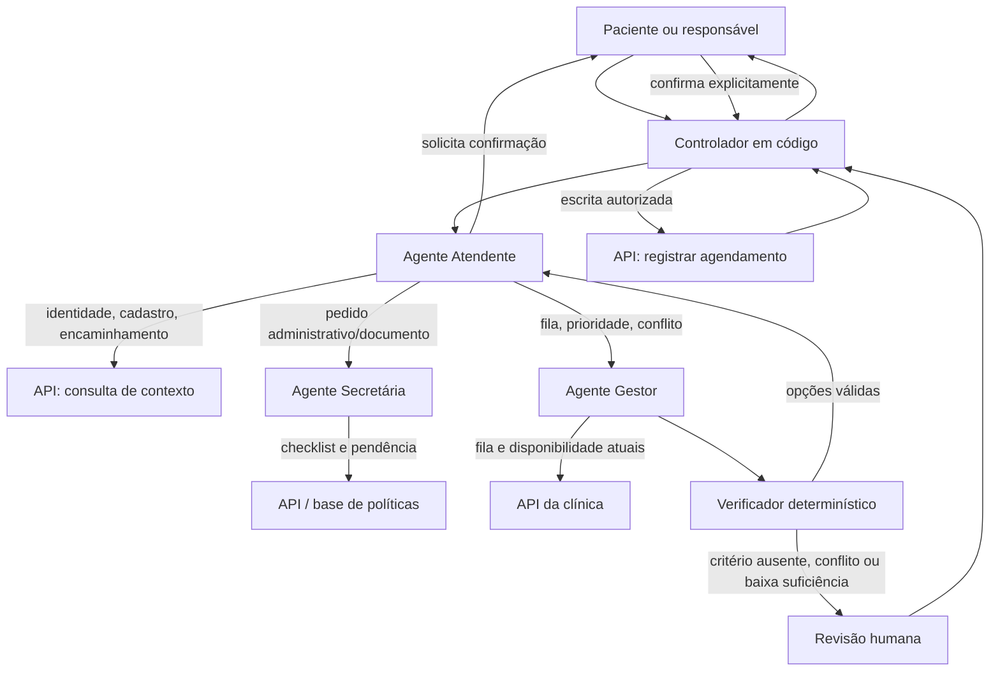

# Arquitetura-alvo

> Este documento descreve o desenho proposto. A integração de agenda e os três agentes ainda não estão implementados no repositório.

## Resumo do sistema

O sistema atende pacientes e responsáveis de uma clínica de avaliações neuropsicológicas por mensagens. Um controlador em código coordena três agentes especializados: Atendente, Gestor e Secretária. Eles consultam dados autorizados na API, mantêm a agenda e as pendências como fonte de verdade e devolvem respostas com fonte e suficiência. O modelo interpreta linguagem e prepara decisões; código valida regras e executa ferramentas. Agendamento só é gravado depois da confirmação do paciente.

## Diagrama

## Roteamento e workflow

O roteador identifica uma destas intenções: **agendamento**, **consulta de dados/fila**, **cancelamento ou remarcação**, **documentos/encaminhamento**, **reclamação** ou **orientação administrativa**. A linguagem natural pode combinar intenções; o controlador cria tarefas separadas e preserva um estado único da conversa. Se faltar informação, houver contradição ou a política não existir, o fluxo pergunta ou encaminha para uma pessoa autorizada.

| Etapa | O que acontece | Quem decide | Ferramenta/escrita | Verificação e reversibilidade |
|---|---|---|---|---|
| 1. Receber e classificar | Interpretar a mensagem e selecionar intenção(ões) | Modelo propõe; código valida as rotas permitidas | Nenhuma | Entrada não reconhecida retorna pedido de esclarecimento |
| 2. Identificar e consultar | Validar identidade/contexto e ler cadastro, encaminhamento, fila e agenda necessários | Código aplica autorização; modelo não escolhe o identificador | Consulta somente leitura à API | API é fonte de verdade; sem identidade autorizada, não revelar dados |
| 3. Tratar pendência administrativa | Conferir se os itens exigidos pela política vigente estão presentes | Secretária aponta pendências; código confere checklist; humano valida conteúdo clínico | Criar ou atualizar tarefa administrativa | Tarefa pode ser reaberta; conteúdo clínico não é inferido |
| 4. Analisar fila | Aplicar somente critérios de prioridade aprovados e versionados | Gestor organiza evidências; código/verificador confere regra e schema; humano aprova exceções | Consulta à API | Sem regra aprovada ou dados suficientes, não calcular prioridade e escalar |
| 5. Propor agenda | Cruzar prioridade autorizada, preferência e disponibilidade atual | Gestor propõe; código checa disponibilidade, conflito e capacidade | Consulta somente leitura | Cada opção deve corresponder a um horário livre retornado pela API |
| 6. Confirmar com paciente | Apresentar fonte, opções e pedir confirmação inequívoca | Paciente decide | Nenhuma | Sem confirmação, não há escrita; silêncio ou ambiguidade não contam como consentimento |
| 7. Registrar ou encaminhar | Gravar agendamento confirmado ou registrar pedido pendente de cancelamento/remarcação | Código executa; paciente confirma agendamento; humano aprova exceções | Escrita na API com chave de idempotência | Não apagar histórico; alteração precisa de trilha de auditoria. Cancelamento só muda status após política oficial e confirmação cabível |
| 8. Responder e encerrar | Informar resultado, fonte e suficiência; registrar metadados mínimos da execução | Código formata objeto; modelo redige a mensagem | Log técnico minimizado | Erro de ferramenta vira estado/resultado explícito e pode ser encaminhado a humano |

## Ferramentas e fronteiras

As ferramentas abaixo são contratos propostos. A API atual do repositório não oferece recursos de agendamento ou pacientes, portanto essas integrações ainda precisam ser implementadas.

| Ferramenta | Finalidade | Leitura/escrita | Reversibilidade e confirmação | Interface/fonte |
|---|---|---|---|---|
| `consultar_contexto_paciente` | Ler cadastro e estado do encaminhamento após autenticação | Leitura | Sem alteração de dados | API da clínica; identidade autenticada, nunca nome como chave de busca |
| `consultar_fila_e_disponibilidade` | Ler posição/status disponível, exames pendentes e horários livres | Leitura | Sem alteração de dados | API da clínica; dados atuais, não RAG |
| `abrir_pendencia_administrativa` | Registrar documento faltante ou solicitar revisão | Escrita | Pode ser fechada/reaberta com histórico; não altera prontuário | API/tarefa administrativa; exige paciente/caso autorizado e motivo estruturado |
| `registrar_agendamento` | Reservar a opção que o paciente confirmou | Escrita | Não há exclusão física; cancelamento posterior é fluxo separado e auditado. Exige confirmação explícita e chave de idempotência | API da clínica; valida disponibilidade novamente no momento da escrita |
| `registrar_pedido_de_cancelamento` | Registrar solicitação para processamento conforme política | Escrita pendente | Não cancela por si só; gestor/humano confirma a ação conforme regra aprovada | API da clínica; preserva o agendamento até decisão válida |

Os dados de paciente, encaminhamento e agenda vêm da API. O RAG pode responder somente regras administrativas publicadas e vigentes, como documentos exigidos e procedimento aprovado para cancelamento. Se a fonte não existir ou estiver desatualizada, a resposta é insuficiente.

## Estado compartilhado

O controlador mantém um estado mínimo para retomar o fluxo:

- `conversation_id` e `patient_id` autenticado, quando disponível;
- rota(s), etapa atual e identificador da tarefa;
- preferência de horário, encaminhamento (estado/status, não cópia do documento), prioridade e versão do critério, se autorizados;
- opções devolvidas pela API, opção escolhida, confirmação explícita e resultado da escrita;
- pendências, fonte consultada, suficiência, tentativas e erro de ferramenta.

Agentes recebem apenas os campos necessários para sua tarefa. Não se copia laudo ou histórico completo para o estado, prompt ou log. O conteúdo clínico permanece na API oficial, sujeito às regras institucionais de acesso e retenção.

## Laço, orçamento e término

- **Laço de conversa:** permanece ativo enquanto houver pergunta ou ação pendente e o paciente quiser continuar.
- **Laço de dados:** pergunta um campo necessário, atualiza o estado e repete a consulta; não volta a pedir um dado já confirmado sem motivo.
- **Limites iniciais de engenharia:** até 8 etapas do workflow, até 10 chamadas combinadas de modelo/ferramentas, até 6.000 tokens de modelo e até 120 segundos por execução. São limites propostos e ainda não medidos; uma chamada de ferramenta com erro conta no orçamento.
- **Término normal:** conclusão da consulta, agendamento confirmado, solicitação registrada como pendente, usuário encerra ou não há ação disponível.
- **Término seguro:** cadastro não localizado, encaminhamento ausente/inválido, contradição não resolvida, insuficiência de fonte, falha repetida da API ou orçamento atingido. A resposta explica o limite e o próximo passo; não simula sucesso.
- **Erro como dado:** cada erro tem etapa, ferramenta, classe do erro, tentativas e resultado de recuperação. Segredos e conteúdo clínico não entram no log.

## Complexidade e encaminhamento humano

| Situação | Resposta do sistema |
|---|---|
| Informação necessária não foi fornecida | Solicitar somente o campo ausente e explicar por que é necessário |
| Mensagem e cadastro divergem | Não escolher silenciosamente; confirmar com paciente ou encaminhar ao responsável |
| Fonte ou regra é insuficiente | Dizer que não consegue confirmar e apontar a fonte que falta |
| Risco, exceção, prioridade sem política, conflito ou erro persistente | Suspender escrita e criar encaminhamento humano com contexto mínimo |

O humano pode interromper a conversa. O responsável da clínica revisa prioridade e exceções; o paciente/responsável confirma o próprio agendamento.

## Nível de autonomia

O sistema usa um agente com ferramentas e workflow sequencial: é mais capaz que um FAQ porque interpreta mensagens abertas, consulta dados atuais e coordena três especialidades. Não usa planejamento autônomo aberto porque os limites são sensíveis, as escritas têm efeito real e a política pode estar incompleta. A autonomia fica restrita a classificar, consultar, preparar opções e registrar ações explicitamente confirmadas.
